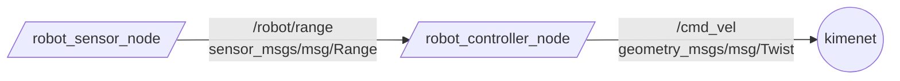

# `nem_yrc_robot` package

ROS 2 C++ package. [](https://docs.ros.org/en/humble/)

Kis beadandó az *Autonóm járművek és robotok programozása* tárgyhoz.

A package két node-ból áll:

- `/robot_sensor_node`: egy szimulált távolságszenzor. Egy akadály előtt ide-oda mozgó robot távolságát állítja elő (szinuszos jel + zaj), és `sensor_msgs/msg/Range` típusú üzenetként hirdeti a `/robot/range` topicban (10 Hz).
- `/robot_controller_node`: feliratkozik a `/robot/range` topicra, és a távolság alapján sebességparancsot (`geometry_msgs/msg/Twist`) hirdet a `/cmd_vel` topicban:
  - `range < stop_distance`: a robot megáll és fordul,
  - `stop_distance <= range < slow_distance`: a sebesség lineárisan csökken,
  - egyébként: `max_speed` sebességgel halad.

  Az aktuális állapotot másodpercenként kiírja a terminálba.

## Node-ok és topicok kapcsolata



## Paraméterek

| Node | Paraméter | Alapérték | Leírás |
|------|-----------|-----------|--------|
| `robot_sensor_node` | `min_range` | 0.2 | minimális mérhető távolság [m] |
| `robot_sensor_node` | `max_range` | 4.0 | maximális mérhető távolság [m] |
| `robot_sensor_node` | `publish_rate_hz` | 10.0 | publikálási frekvencia [Hz] |
| `robot_controller_node` | `stop_distance` | 0.8 | ennél közelebb megáll és fordul [m] |
| `robot_controller_node` | `slow_distance` | 2.0 | ennél közelebb lassít [m] |
| `robot_controller_node` | `max_speed` | 1.0 | maximális haladási sebesség [m/s] |
| `robot_controller_node` | `turn_speed` | 0.6 | fordulási szögsebesség [rad/s] |

## Packages and build

It is assumed that the workspace is `~/ros2_ws/`.

### Clone the packages

```bash
cd ~/ros2_ws/src
```

```bash
git clone https://github.com/Ngeri13/nem_yrc_robot
```

### Build ROS 2 packages

```bash
cd ~/ros2_ws
```

```bash
colcon build --packages-select nem_yrc_robot --symlink-install
```

**Don't forget to source before ROS commands.**

```bash
source ~/ros2_ws/install/setup.bash
```

### Futtatás

Mindkét node egyszerre, launch fájllal:

```bash
ros2 launch nem_yrc_robot robot.launch.py
```

Külön-külön, két terminálban:

```bash
ros2 run nem_yrc_robot robot_sensor_node
```

```bash
ros2 run nem_yrc_robot robot_controller_node
```

### Ellenőrzés

```bash
ros2 topic list
ros2 topic echo /robot/range
ros2 topic echo /cmd_vel
ros2 topic hz /robot/range
rqt_graph
```

Paraméter módosítása futás közben:

```bash
ros2 param set /robot_controller_node max_speed 2.0
```

Várt kimenet a vezérlő node terminálján (példa):

```text
[robot_controller_node]: tavolsag: 3.12 m -> v: 1.00 m/s, w: 0.00 rad/s [HALAD]
[robot_controller_node]: tavolsag: 1.45 m -> v: 0.54 m/s, w: 0.00 rad/s [LASSIT]
[robot_controller_node]: tavolsag: 0.55 m -> v: 0.00 m/s, w: 0.60 rad/s [MEGALL, FORDUL]
```

## Licenc

GPL-3.0, lásd a `LICENSE` fájlt.
